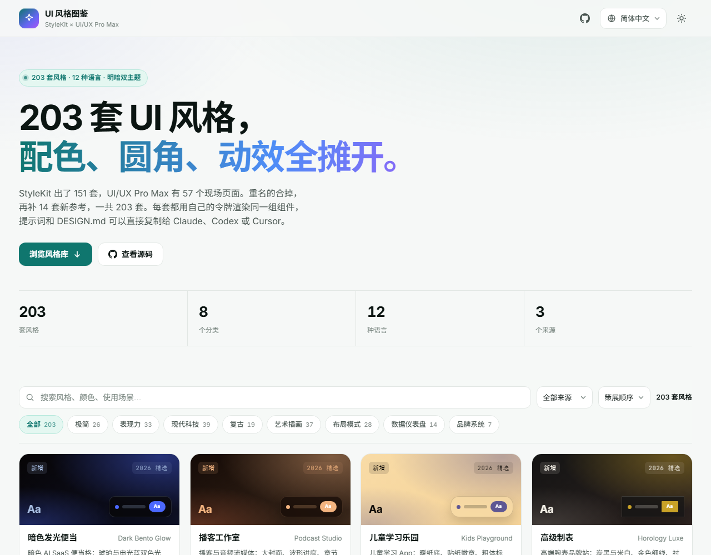
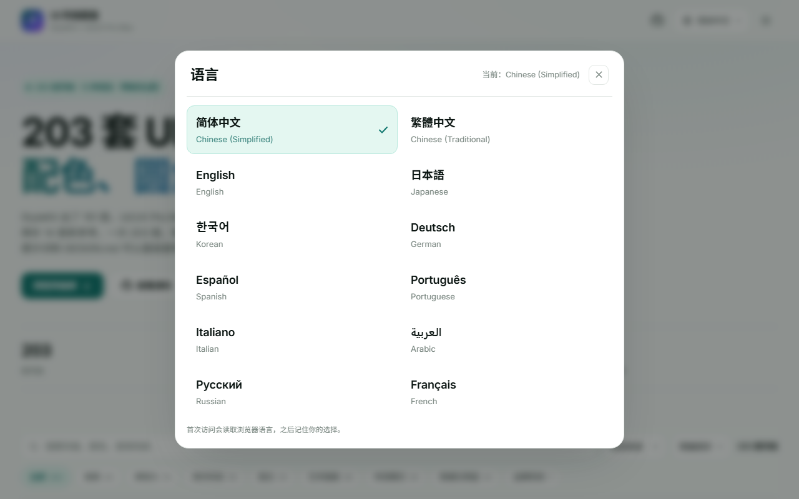
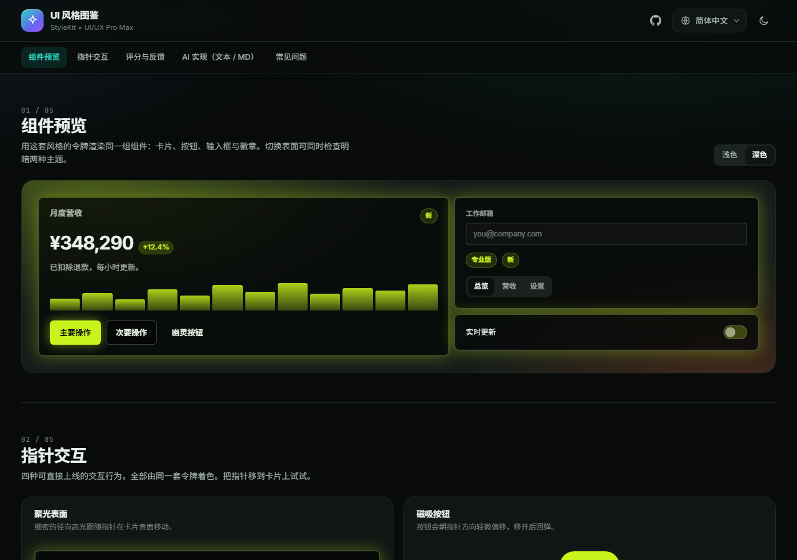
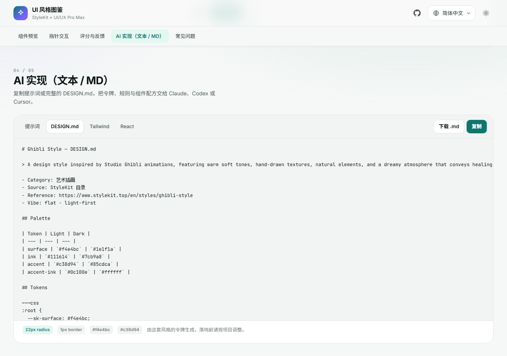
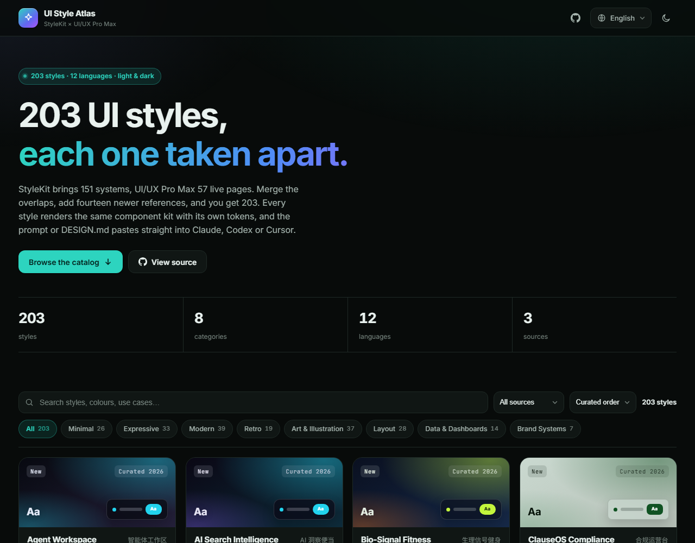
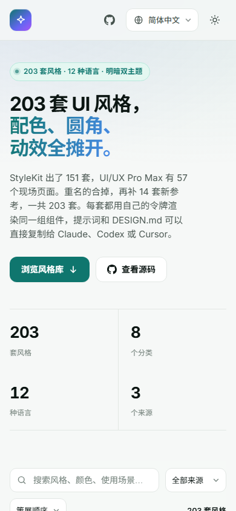

# UI Style Atlas · UI 风格图鉴

203 套 UI 风格，12 种语言，明暗两套主题。每套都带组件预览、指针交互、评分面板，以及能直接复制走的提示词和 `DESIGN.md`。

- 线上：<https://uitest.opkg.cn>
- 源码：<https://github.com/PIKACHUIM/uitest>



## 内容来源

| 来源 | 数量 | 说明 |
| --- | --- | --- |
| UI/UX Pro Max 原创集 | 57 | `styles/` 下的独立演示页，可从卡片直接打开 |
| StyleKit（MIT） | 132 | 上游 151 套，去掉与原创集重名的 19 套 |
| 2026 参考 | 14 | liquid-glass-react 与 Dribbble 上的真实案例，按公开画面重建配色与规则 |
| 合计 | **203** | 8 个分类：极简 26、现代 39、表现力 33、复古 19、布局 28、数据 14、艺术 37、品牌 7 |

`assets/data/catalog.js` 是合并后的快照：名称、简繁描述、分类、来源、配色、圆角、边框、气质、标签、Do/Don't、参考链接都在里面。改这个文件刷新页面就生效，没有构建步骤。

## 多语言

12 种语言，界面文案全部翻译，不只是翻标题。入口是页头的语言按钮，弹出双栏列表。

| 顺序 | 代码 | 本地名 | 备注 |
| --- | --- | --- | --- |
| 1 | `zh-CN` | 简体中文 | |
| 2 | `zh-TW` | 繁體中文 | |
| 3 | `en` | English | 兜底语言 |
| 4 | `ja` | 日本語 | |
| 5 | `ko` | 한국어 | 标题与导语按词断行，不切音节 |
| 6 | `de` | Deutsch | |
| 7 | `es` | Español | |
| 8 | `pt` | Português | |
| 9 | `it` | Italiano | |
| 10 | `ar` | العربية | 全站 RTL |
| 11 | `ru` | Русский | |
| 12 | `fr` | Français | |

- 首次访问读 `navigator.languages`：`zh-Hant` / `zh-TW` / `zh-HK` / `zh-MO` 走繁体，其余 `zh-*` 走简体，再按 `ja`、`ko`、`de`、`es`、`pt`、`it`、`ar`、`ru`、`fr` 前缀匹配，都不中就用英文。
- 选择存进 `localStorage['atlas:lang']`；`?lang=xx` 只对当次生效，不写入。
- 阿拉伯语给 `<html>` 加 `dir="rtl"`，页头、卡片、详情页和评分面板整站镜像。
- 加一门语言：在 `assets/i18n.js` 的 `locales` 数组和 `dict` 里各加一条。每种语言 140 个键，缺键时回落英文。



## 风格详情页

点任意卡片进入 `style.html?s=<id>`，五个板块：

1. **组件预览** — 用这套风格的令牌渲染同一组组件（卡片、按钮、输入框、徽章、开关、标签页），可切浅色 / 深色表面。
2. **指针交互** — 聚光表面、磁吸按钮、3D 倾斜、涟漪按压，颜色同样来自令牌，遵循 `prefers-reduced-motion`。
3. **评分与反馈** — 1–5 分加标签和备注，存在 `localStorage['atlas:rating:<id>']`，只在本机。
4. **AI 实现** — 提示词、`DESIGN.md`、Tailwind、React 四个标签，可一键复制或下载 `.md`。
5. **常见问题** — 五个问答，答案里填入这套风格的令牌数值，另有来源与参考链接。





## 明暗主题

默认跟随系统 `prefers-color-scheme`。按钮循环 跟随系统 → 白天 → 暗黑，选择存在 `localStorage['atlas:theme']`，同时更新 `theme-color`；`?theme=dark` 可临时指定。



## 检索与筛选

关键词匹配名称、描述、标签和颜色；可按 8 个分类、3 个来源筛选，按策展顺序、A→Z 或分类排序。分类芯片上带实时数量。

## 移动端

390px 宽下没有横向滚动，筛选条改为横向滑动，语言弹窗收成单栏。



## 目录结构

```
uitest/
├── index.html                 # 图鉴首页：检索 / 筛选 / 语言 / 主题
├── style.html                 # 风格详情页（?s=<id>）
├── assets/
│   ├── app.css                # 设计系统、详情页、弹窗、双主题变量
│   ├── app.js                 # 主题、语言、页头页脚、弹窗、卡片网格
│   ├── i18n.js                # 12 种语言字典（每种 140 键）
│   ├── style-page.js          # 详情页五个板块、提示词与代码生成
│   └── data/catalog.js        # 203 条风格快照
├── styles/                    # 57 个原创独立演示页
├── screenshots/               # 本 README 的截图
└── CNAME                      # uitest.opkg.cn
```

## 本地预览

```bash
python -m http.server 8123
```

打开 <http://127.0.0.1:8123/index.html>。直接双击 `index.html` 也能看，但 `file://` 下剪贴板和部分字体加载会被浏览器拦。

### 深链

```
index.html?lang=ja&theme=dark
style.html?s=racing-telemetry
style.html?s=dark-mode          # 别名，跳到 dark-mode-oled
```

`s` 参数依次试：风格 id、StyleKit slug、名称前缀、demo 文件名，都不中则回首页。

## 部署

纯静态，没有构建步骤：

- **GitHub Pages**：Settings → Pages → Source 选 `main`，根目录发布
- **Netlify / Cloudflare Pages**：直接指向仓库根目录
- **自定义域名**：`CNAME` 已经写成 `uitest.opkg.cn`

## 浏览器支持

需要 CSS 自定义属性、`backdrop-filter`、`color-mix()`、`:has` 和逻辑属性：Chrome / Edge 111+、Safari 16.4+、Firefox 113+。主题跟随系统，动效跟随 `prefers-reduced-motion`。

## 授权与致谢

- 本站代码：MIT
- 风格数据：[StyleKit](https://github.com/AnxForever/stylekit)（MIT）与 UI/UX Pro Max 原创集
- 液态玻璃参考：[rdev/liquid-glass-react](https://github.com/rdev/liquid-glass-react)（MIT）
- Dribbble 参考：Cartex 赛车仪表盘、VoiceAI、Banking App、Kiki 儿童教育、Podcast App、Fitness Tracker、Valencia Timepieces、AI Agent Workspace、ClauseOS、Vexto、TripAI、Dark Bento Glow、AI Search Intelligence 等公开作品。只参考设计语言和配色，未复制素材。
